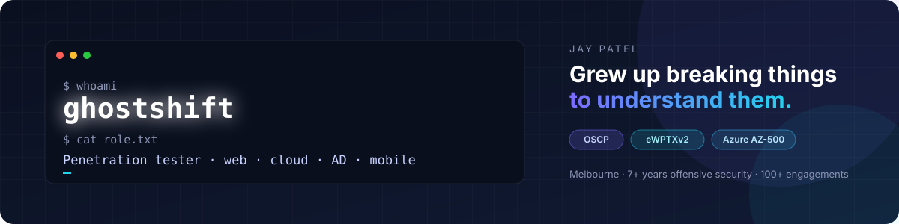

# Hello friend 👋

I'm **Jay**, a penetration tester working under the handle **GhostShift**. Seven-plus years of offensive security and more than a hundred engagements across web applications, cloud, Active Directory, APIs, mobile and internal networks, for public and private sector clients around the world. I like realistic attack simulation and manual exploitation, and I like explaining what an attacker sees in a way the people who own the system can act on.

Lately I've been building tooling that maps a codebase before anyone hunts in it, so that findings come with evidence instead of opinions.

## Certifications 🎓

  
  
  
  
  

| Certification | Issuer | Issued | Verify |
|---|---|---|---|
| **OffSec Certified Professional (OSCP)** | OffSec | Aug 2023 | [credential.net](https://www.credential.net/ffae760e-8df7-499c-8247-5c5f8d109f36) |
| **Web Application Penetration Tester eXtreme (eWPTXv2)** | eLearnSecurity / INE | | |
| **Microsoft Certified: Azure Security Engineer Associate (AZ-500)** | Microsoft | Jun 2020 | [Credly](https://www.credly.com/badges/d271da48-a344-4ce2-bcd0-e578639ee064) |
| **Cloud Essentials** learning path | OffSec | | [credentials.offsec.com](https://credentials.offsec.com/09f0a39d-ed40-4f92-9809-321095bf3111) |
| **ISTQB® Certified Tester, Foundation Level** | iSQI | Apr 2022 | [skillshub.isqi.org](https://skillshub.isqi.org/975a4976-cefe-4e75-b2b8-e14f411f401f?key=85d662da0da4afd2ef99028e455119cf2c9b8e85ca7a7f8f9ef60fe6ef95d45d) |

## Publications ✍️

| Title | Where | What it shows |
|---|---|---|
| [Full Account Takeover via AWS Cognito Misconfiguration](https://www.cobalt.io/blog/full-account-takeover-via-aws-cognito-misconfiguration) | Cobalt Blog · Feb 2026 | A user pool that lets users edit their own email attribute, plus an app that identifies accounts by email instead of the `sub` claim, lets any account log in as any other via a case-variant address. |
| [ADCS-ESC1: Misconfigured Certificate Templates Leading to Full Domain Compromise](https://www.cobalt.io/blog/adcs-esc1-misconfigured-certificate-templates-leading-to-full-domain-compromise) | Cobalt Blog · Mar 2026 | How one over-permissive AD CS template lets a low-privileged domain user mint a certificate for an administrator, with exploitation, detection and remediation. |
| Prevention of Cross-Site Scripting Attacks in Web Applications | IEEE EECCMC · also in Springer AISC vol. 1150 ([chapter](https://doi.org/10.1007/978-3-030-44038-1_100)) | A rule-based framework for hardening web applications against XSS, reviewed against the traditional prevention methods. |

More posts on [the Cobalt author page](https://www.cobalt.io/blog/author/ghostshift).

## CVEs 🧨

<!-- cve-list:start -->
_CVE credits are being added. Watch this space._
<!-- cve-list:end -->

## What I'm building 🛠️

**[SecForge](https://github.com/ghostshift-content/secforge)** — *Map once, hunt anywhere.* A self-contained white-box security workbench. It freezes a snapshot of any codebase, maps it into a cited knowledge graph of features, entry points, roles and permissions (an agentic Lead reads the frozen source with read-only tools and every claim is proven back to a `file:line`), renders an access matrix per feature showing who can and cannot reach each endpoint, and then runs feature-by-feature assessments where every finding is corroborated by a deterministic rule. Zero npm dependencies, runs on loopback, nothing leaves your machine.

## How I work 🔍

- **Access control first.** Most of the damage I've seen in real estates comes from authorization that was assumed rather than enforced: IDOR, tenant boundary slips, role ladders that only exist in the UI.
- **Identity and cloud.** Cognito, Entra ID, AD CS, token lifecycles, the seams between an SPA, a gateway and the system of record.
- **Evidence over claims.** A finding is a reproducible request, a cited line of code, or it is not a finding.
- **Burp Suite in one hand, a notebook in the other.** Documentation is the safety net of every test.

## Find me around the web 🌎

- Research write-ups on the [Cobalt Blog](https://www.cobalt.io/blog/author/ghostshift) 📝
- Career updates and longer posts on [LinkedIn](https://www.linkedin.com/in/jaypatelk) 💼
- Code and tooling right here on [GitHub](https://github.com/ghostshift-content) 📫

  
  

Everything here is my own work and opinion. Engagement details stay with the clients they belong to.

